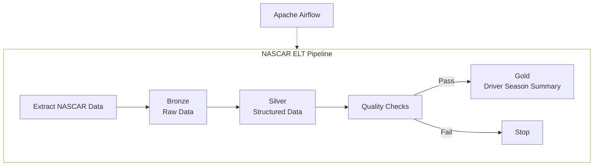

# NASCAR Race ELT Pipeline

An end-to-end batch pipeline that transforms **2025 NASCAR Cup Series data** into driver-season performance summaries.

Python extracts race data from NASCAR’s REST endpoints, Snowflake stores and transforms it through **Bronze, Silver, and Gold layers**, and Apache Airflow coordinates execution. The local development environment runs with Docker and the Astronomer Astro CLI.

## Technology Stack

| Technology | Role |
| --- | --- |
| Python and `requests` | API extraction and response validation |
| Snowflake and SQL | JSON storage, relational transformations, and analytical aggregation |
| `snowflake-connector-python` | Authentication, file loading, and SQL execution |
| Apache Airflow | Task scheduling, dependencies, and retries |
| Docker and Astro CLI | Local Airflow environment |
| pandas | Optional CSV export and exploration |

## Architecture

The diagram shows **execution order**, with Airflow coordinating all five tasks.



Quality checks run **after Silver is built**. They read Bronze and Silver, including comparing their result counts. A failed check blocks the Gold build.

Gold reads its data directly from Silver. The arrows represent task dependencies, not data passing through the quality checks. Snowflake executes the warehouse SQL; the enclosing box represents Airflow’s orchestration scope.

## Data Sources and Extraction

The pipeline uses two NASCAR JSON endpoints:

| Source | Endpoint |
| --- | --- |
| Season event list | `https://cf.nascar.com/cacher/2025/1/race_list_basic.json` |
| Race weekend feed | `https://cf.nascar.com/cacher/2025/1/{race_id}/weekend-feed.json` |

[`include/extract.py`](include/extract.py) saves the season event list, selects points-paying races using `race_type_id == 1`, and requests each selected race’s weekend feed sequentially.

Extraction includes:

- A 30-second timeout and HTTP status validation for each request.
- Validation that the returned race ID matches the requested race.
- A check that race results are present.
- Preservation of original JSON responses under `include/data/raw/`.

The season and series are fixed to **2025 Cup Series**. Each run requests that dataset again rather than extracting only new races.

## Snowflake Data Layers

All warehouse objects belong to the `NASCAR_RACE_ELT` database.

### Bronze — Original API Responses

[`include/load_bronze.py`](include/load_bronze.py) uploads local JSON files to `BRONZE.RAW_JSON_STAGE` using `PUT`, then loads them into `BRONZE.RAW_NASCAR_JSON` with `COPY INTO`.

The table retains:

| Column | Content |
| --- | --- |
| `RAW_DATA` | Original JSON stored as `VARIANT` |
| `SOURCE_FILE` | Source filename |
| `LOADED_AT` | Ingestion scan timestamp |

The JSON format preserves outer arrays, and loading errors abort the copy statement.

### Silver — Structured Race Data

[`include/sql/build_silver.sql`](include/sql/build_silver.sql) extracts typed fields from JSON and expands nested driver results using `LATERAL FLATTEN`.

| Table | Intended grain | Merge key |
| --- | --- | --- |
| `SILVER.RACES` | One record per race | `race_id` |
| `SILVER.RACE_RESULTS` | One record per driver per race | `race_id`, `driver_id` |

`MERGE` statements update matching records and insert new ones. Race attributes include season, date, track, and field size; driver results include starting position, finishing position, laps completed, and finishing status.

### Gold — Driver-Season Performance

[`include/sql/build_gold.sql`](include/sql/build_gold.sql) rebuilds `GOLD.DRIVER_SEASON_SUMMARY` after quality checks pass.

The summary groups results by season and driver to calculate:

- Starts
- Wins
- Top-five finishes
- Average finishing position, rounded to two decimal places

Only results with a positive starting position contribute to the summary. Nonpositive finishing positions are excluded from average finish.

This table supports performance analysis; it does not calculate championship points or standings.

## Airflow Orchestration

The [`nascar_race_elt`](dags/nascar_race_elt.py) DAG runs five sequential `BashOperator` tasks:

```text
extract → load_bronze → build_silver → check_quality → build_gold
```

| Setting | Configuration |
| --- | --- |
| Schedule | Weekly |
| Start date | January 1, 2025, UTC |
| Catchup | Disabled |
| Maximum active runs | One |
| Task retries | One retry after two minutes |

Each task launches a Python script. [`include/run_sql.py`](include/run_sql.py) executes SQL files in Snowflake; its `--check` option raises an error when a validation query returns any row.

The weekly schedule reruns the fixed 2025 dataset. It does not use Airflow’s execution date to select races. Extraction and loading also depend on access to the same local raw files.

## Data Quality

[`include/sql/check_quality.sql`](include/sql/check_quality.sql) contains five checks. Each query must return **zero rows** before Gold can be rebuilt.

| Check | Failure condition |
| --- | --- |
| Referential integrity | A Silver driver result references a race missing from `SILVER.RACES` |
| Finish-position bounds | A finish or field size is null, field size is nonpositive, or finish falls outside zero through field size |
| Row-count reconciliation | Per-race result counts differ between Bronze and Silver |
| Result uniqueness | Multiple Silver results exist for the same race and driver |
| Event-type validity | An event-list race type is missing or outside the expected values `1` and `2` |

These checks run after Silver writes and do not roll them back. A failed check prevents that run’s Gold rebuild, but an existing Gold table remains available.

## Repository Structure

```text
├── dags/
│   └── nascar_race_elt.py       # Airflow workflow
├── include/
│   ├── extract.py              # NASCAR API extraction
│   ├── load_bronze.py          # Snowflake staging and loading
│   ├── run_sql.py              # SQL execution and quality enforcement
│   └── sql/
│       ├── build_silver.sql
│       ├── check_quality.sql
│       └── build_gold.sql
├── csvs/
│   ├── extract_csv.py          # Optional CSV export
│   └── validate_csvs.py        # Counts and duplicate reporting
├── tests/
│   └── dags/
│       └── test_dag_example.py # Astronomer starter tests
├── Dockerfile
├── requirements.txt
├── packages.txt
└── README.md
```

Generated datasets, environment files, and private-key files are excluded through Git ignore rules.

## Local Setup

### 1. Prepare the Environment

You will need:

- Docker with its engine running.
- Astronomer Astro CLI.
- A Snowflake account and user configured for key-pair authentication.
- A local checkout of this repository.

The Dockerfile uses Astro Runtime `3.3-12`. `requirements.txt` declares `requests` and `snowflake-connector-python`; Airflow is supplied by the runtime image.

### 2. Provision Snowflake Objects

Bootstrap DDL and access grants are not included in the repository. Before running the pipeline, prepare:

| Object | Required structure |
| --- | --- |
| Database | `NASCAR_RACE_ELT` |
| Schemas | `BRONZE`, `SILVER`, `GOLD` |
| Internal stage | `BRONZE.RAW_JSON_STAGE` |
| Bronze table | `BRONZE.RAW_NASCAR_JSON`: `RAW_DATA VARIANT`, `SOURCE_FILE VARCHAR`, and timestamp-compatible `LOADED_AT` |
| Silver race table | `SILVER.RACES`, matching the column names and types selected in `build_silver.sql` |
| Silver results table | `SILVER.RACE_RESULTS`, matching the column names and types selected in `build_silver.sql` |

The connection does not specify a role. The user’s effective default role needs warehouse usage, database/schema access, stage read/write access, Bronze select/insert permissions, Silver select/insert/update permissions, and permission to create or replace the Gold table.

**Warehouse requirement:** The Bronze loader hardcodes `SYSTEM$STREAMLIT_NOTEBOOK_WH`. Transformations use `SNOWFLAKE_WAREHOUSE`. Setting that environment variable does not change the loader’s warehouse; the loader cannot run as written if its hardcoded warehouse is unavailable.

### 3. Configure Authentication

Provide these environment variables to the Airflow task containers using a private, Git-ignored root `.env` file:

| Variable | Purpose |
| --- | --- |
| `SNOWFLAKE_ACCOUNT` | Snowflake account identifier |
| `SNOWFLAKE_USER` | User configured for key-pair authentication |
| `SNOWFLAKE_PRIVATE_KEY_FILE` | Absolute private-key path inside the container |
| `SNOWFLAKE_PRIVATE_KEY_PASSPHRASE` | Key passphrase for unattended execution |
| `SNOWFLAKE_WAREHOUSE` | Warehouse used by the SQL runner |

Mount the private key read-only into the containers that execute tasks. The tracked repository does not include this mount configuration. A host path alone does not make the key accessible inside Docker.

Keep private keys outside the Docker build context. Do not commit credentials or put them in the Dockerfile.

The scripts read environment variables directly rather than using Airflow Connections. Supply the passphrase explicitly: the Bronze loader otherwise prompts interactively, while the SQL runner requires the variable.

### 4. Start Airflow

With Docker running, execute from the repository root:

```bash
astro dev start
```

Once startup completes, open [Airflow at localhost:8080](http://localhost:8080/), enable `nascar_race_elt`, and trigger a run. Inspect the task logs in execution order.

**The local Airflow link works only while the environment is running on your computer.** GitHub hosts the repository, not the Airflow service.

To stop the environment:

```bash
astro dev stop
```

### 5. Query the Results

After a successful pipeline run:

```sql
SELECT
    race_season,
    driver_name,
    starts,
    wins,
    top_five_finishes,
    average_finish
FROM NASCAR_RACE_ELT.GOLD.DRIVER_SEASON_SUMMARY
ORDER BY
    wins DESC,
    top_five_finishes DESC,
    average_finish ASC;
```

### Optional CSV Exploration

The scripts under `csvs/` provide an independent path for exporting and inspecting the data:

```bash
python csvs/extract_csv.py
python csvs/validate_csvs.py
```

They generate event and driver-result CSV files, then print counts, duplicate counts, and sample rows. pandas must be available separately because it is not declared in `requirements.txt`. The validator reports duplicates without raising an error.

## Engineering Decisions

- **Preserve source data before transformation.** Original JSON and ingestion metadata support traceability and inspection of the source payloads.
- **Separate storage and modeling responsibilities.** Bronze retains raw responses, Silver establishes relational grains, and Gold provides an analytical summary.
- **Perform transformations in Snowflake.** JSON paths, casts, `LATERAL FLATTEN`, and SQL aggregation demonstrate warehouse-centered ELT.
- **Use key-based merges for Silver.** Existing records can be updated without blindly appending every extraction. This still depends on unique source keys and correct loading behavior.
- **Make validation an explicit dependency.** SQL checks become a required Airflow task before Gold is rebuilt.
- **Keep orchestration straightforward.** Sequential tasks, one active run, and task retries provide a workflow that is easy to inspect and troubleshoot.

## Scope and Limitations

This project implements a fixed-season batch workflow. It does not include incremental watermarks, source-version deduplication, an explicit correction/reload strategy, or stale-file cleanup. Silver merges do not delete records removed upstream.

Quality checks validate selected consistency rules, but do not guarantee nonempty data, freshness, a complete season, or correct Gold metrics. Execution is not transactional across the entire pipeline.

The committed Astronomer starter tests expect DAG tags and at least two retries; the current DAG has no tags and one retry. Those assertions conflict with the implementation and should not be treated as passing project validation.

Python dependencies are unpinned. Custom alerting, CI/CD, deployment automation, and dashboards are outside the implemented scope.
