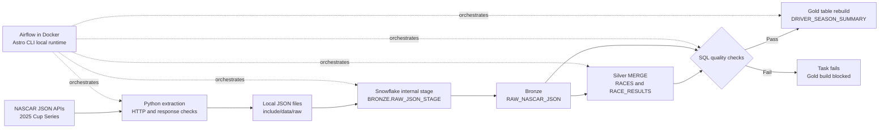

# NASCAR Race ELT Pipeline

A batch data engineering project that extracts **2025 NASCAR Cup Series** race data from NASCAR's JSON REST endpoints, loads original responses into Snowflake, and transforms them into relational race results and driver-season summaries. Apache Airflow orchestrates the workflow locally through Docker and the Astronomer Astro CLI.

The project demonstrates warehouse-centered ELT, semi-structured data modeling, task dependencies, and SQL quality gates. Its implemented scope is a fixed-season portfolio pipeline; it is not a production deployment or a live race-tracking service.

## Architecture



Raw payloads move through files and Snowflake tables; the DAG does not pass datasets through XCom. Transformation SQL runs in Snowflake through the Python connector.

## Technology stack

| Technology | Implemented role |
| --- | --- |
| Python | HTTP extraction, local file handling, Snowflake loading, and SQL execution |
| `requests` | REST requests with a 30-second timeout and HTTP status checks |
| Snowflake | Internal staging, JSON storage, relational transformations, quality queries, and aggregation |
| `snowflake-connector-python` | Key-pair authentication, `PUT`, `COPY INTO`, and SQL execution |
| Apache Airflow | Five sequential `BashOperator` tasks using the Airflow SDK and standard provider |
| Docker / Astro CLI | Local Airflow runtime defined by `astrocrpublic.azurecr.io/runtime:3.3-12` |
| pandas | Optional standalone CSV exploration scripts; not used by the DAG |

`requirements.txt` declares `requests` and `snowflake-connector-python` without version pins. Airflow comes from the Astro Runtime image. `packages.txt` is empty. pandas is not explicitly declared in the project requirements.

## Data sources and extraction

The code calls two NASCAR endpoints without API credentials:

- Season event list: `https://cf.nascar.com/cacher/2025/1/race_list_basic.json`
- Per-race weekend feed: `https://cf.nascar.com/cacher/2025/1/{race_id}/weekend-feed.json`

In these URLs, the implementation fixes the season to `2025` and series to `1` (Cup Series). They are not DAG parameters.

[`include/extract.py`](include/extract.py):

1. Fetches the event list, checks the HTTP response, parses the JSON, and saves the original response as `include/data/raw/race_list_2025.json`.
2. Selects events with `race_type_id == 1` for points-race extraction. The script's comment identifies 36 points races, but the actual loop follows the returned event list and does not assert a fixed count.
3. Requests each selected race sequentially and reads `weekend_race[0]`.
4. Rejects a feed when its race ID differs from the requested ID or its results are empty.
5. Saves the original weekend response as `race_{race_id}_{YYYY-MM-DD}.json` and logs progress.

Each HTTP request has a 30-second timeout and uses `raise_for_status()`. There is no request-level retry loop; Airflow retries the entire extraction task. Extraction downloads the fixed season again on every run and does not clear stale local files.

## Snowflake data layers

All SQL targets the database `NASCAR_RACE_ELT`.

### Bronze: original responses and ingestion metadata

[`include/load_bronze.py`](include/load_bronze.py) uploads all JSON files in `include/data/raw/` to `BRONZE.RAW_JSON_STAGE`, lists staged files, and copies data into `BRONZE.RAW_NASCAR_JSON`:

| Column | Loaded value |
| --- | --- |
| `RAW_DATA` | JSON document (`VARIANT`) |
| `SOURCE_FILE` | `METADATA$FILENAME` |
| `LOADED_AT` | `METADATA$START_SCAN_TIME` |

`STRIP_OUTER_ARRAY = FALSE` preserves the outer event-list array. `ON_ERROR = ABORT_STATEMENT` fails the copy on a loading error. The script prints the total Bronze row count; this is an observation, not a row-count assertion.

The loader does not truncate Bronze, force reloads, overwrite staged files explicitly, or implement version selection. It relies on Snowflake's default stage and copy behavior. Re-fetching a changed API response under an existing filename is not an implemented refresh strategy.

### Silver: typed race and driver-result tables

[`include/sql/build_silver.sql`](include/sql/build_silver.sql) uses two `MERGE` statements:

| Table | Intended grain / merge key | Columns extracted |
| --- | --- | --- |
| `SILVER.RACES` | One row per `race_id` | `race_id`, `race_season`, `race_name`, `race_date`, `track_name`, `number_of_cars_in_field` |
| `SILVER.RACE_RESULTS` | One row per `(race_id, driver_id)` | `race_id`, `driver_id`, `driver_name`, `starting_position`, `finishing_position`, `laps_completed`, `finishing_status` |

JSON paths select `weekend_race[0]`, explicit casts establish relational types, and `LATERAL FLATTEN` expands nested driver results. Dates use the first ten characters of the source date. Matches update all columns by name; new keys insert all columns by name.

The event-list document is retained in Bronze but does not become a separate Silver table. The transformations neither deduplicate Bronze inputs nor delete Silver rows that disappear from the source. Their repeatability depends on unique, consistent source keys.

### Gold: driver-season summary

After the quality gate passes, [`include/sql/build_gold.sql`](include/sql/build_gold.sql) rebuilds `GOLD.DRIVER_SEASON_SUMMARY` with `CREATE OR REPLACE TABLE ... AS SELECT`.

Rows are grouped by `race_season` and `driver_id`, using only results with `starting_position > 0`:

| Output | Calculation |
| --- | --- |
| `driver_name` | `MAX(driver_name)` within the group |
| `starts` | Number of included result rows |
| `wins` | Count of finishing positions equal to 1 |
| `top_five_finishes` | Count of finishing positions from 1 through 5 |
| `average_finish` | Mean of positive finishing positions, rounded to two decimals |

This table supports season-level performance analysis. It does not calculate championship standings, playoff points, or official NASCAR points totals.

## Airflow orchestration

The DAG in [`dags/nascar_race_elt.py`](dags/nascar_race_elt.py) is named `nascar_race_elt`:

```text
extract → load_bronze → build_silver → check_quality → build_gold
```

| Setting | Value |
| --- | --- |
| Schedule | `@weekly` |
| Start date | January 1, 2025, UTC |
| Catchup | Disabled |
| Concurrent DAG runs | At most one |
| Task retries | One retry after a two-minute delay |
| Container script directory | `/usr/local/airflow/include` |

Each task launches a Python script with `BashOperator`. `run_sql.py` executes SQL files statement by statement using `connection.execute_stream()`. With `--check`, it raises an exception if a statement returns any row, including the first failing row in the error message. Downstream tasks require upstream success, so a failed quality check prevents that run's Gold rebuild.

The weekly schedule reruns the fixed 2025 dataset; it does not use Airflow's logical date to select new races. Tasks share local raw files, so extraction output must remain available to the loading task. No custom alerting or remote deployment configuration is included in the tracked project.

## Data-quality checks

[`include/sql/check_quality.sql`](include/sql/check_quality.sql) contains five queries. Each must return **zero rows**:

| Check | Failure condition |
| --- | --- |
| Referential integrity | A Silver driver result references a race missing from `SILVER.RACES` |
| Finish-position bounds | Finish or field size is null, field size is nonpositive, finish is negative, or finish exceeds field size |
| Bronze-to-Silver reconciliation | Per-race flattened Bronze result counts differ from Silver result counts |
| Result uniqueness | More than one Silver row exists for the same `(race_id, driver_id)` |
| Event-type validity | An event-list entry has a missing, nonnumeric, or unexpected race type outside `1` and `2` |

A finishing position of zero is allowed by the quality query; Gold excludes it from the average. These checks do not assert a complete 36-race season, freshness, nonempty tables, all mandatory fields, or the correctness of Gold metrics. An entirely empty dataset can pass the SQL gate. Checks run after Silver writes and do not roll them back. Previously built Gold data can remain when a later run fails the gate.

## Repository structure

The tracked project files are:

```text
.
├── README.md
├── Dockerfile
├── requirements.txt
├── packages.txt
├── .dockerignore
├── .gitignore
├── dags/
│   └── nascar_race_elt.py          # Five-task Airflow workflow
├── include/
│   ├── extract.py                # Fetch and preserve NASCAR JSON
│   ├── load_bronze.py            # Upload and load original payloads
│   ├── run_sql.py                # Execute SQL and enforce zero-row checks
│   └── sql/
│       ├── build_silver.sql       # Race and result MERGEs
│       ├── check_quality.sql      # Five quality queries
│       └── build_gold.sql         # Driver-season aggregate rebuild
├── csvs/
│   ├── extract_csv.py            # Optional CSV export
│   └── validate_csvs.py          # Print CSV counts and duplicates
└── tests/
    └── dags/
        └── test_dag_example.py   # Astronomer starter DAG tests
```

`include/data/raw/` is generated by extraction. Generated datasets, environment files, keys, and several local Astro configuration paths are ignored by Git. Local starter files and configuration may exist outside this tracked tree; they are not prerequisites supplied by a fresh clone.

## Local setup

### 1. Prepare the runtime

Install Docker with its engine running and the Astronomer Astro CLI. Obtain a local checkout of this repository and run the following commands from its root. The existing Dockerfile defines the runtime; there is no need to initialize another Astro project.

### 2. Provision Snowflake prerequisites

The repository does **not** include bootstrap DDL, user provisioning, key registration, or grants. Before running the pipeline, arrange the following in Snowflake:

- Database `NASCAR_RACE_ELT` and schemas `BRONZE`, `SILVER`, and `GOLD`.
- Internal stage `BRONZE.RAW_JSON_STAGE`.
- Table `BRONZE.RAW_NASCAR_JSON` with `RAW_DATA VARIANT`, `SOURCE_FILE VARCHAR`, and a timestamp-compatible `LOADED_AT` column.
- Tables `SILVER.RACES` and `SILVER.RACE_RESULTS` with the exact column names listed above. Use numeric types for IDs, season, counts, and positions; `DATE` for `race_date`; and character types for names and status.
- A Snowflake user configured for key-pair authentication and an effective default role with warehouse usage, database/schema access, stage read/write, Bronze select/insert, Silver select/insert/update, and permission to create or replace the Gold table.
- Compute accessible to that user: **the Bronze loader hardcodes `SYSTEM$STREAMLIT_NOTEBOOK_WH`**, while the SQL runner uses `SNOWFLAKE_WAREHOUSE`. Setting the environment variable does not change the loader's warehouse. If the hardcoded warehouse is unavailable or unusable in your account, the loader cannot run as written.

No role is passed explicitly by either connection function. Gold is created by the transformation, but its database and schema must already exist.

### 3. Supply authentication locally

Provide these environment variables to the Airflow task containers:

| Variable | Purpose |
| --- | --- |
| `SNOWFLAKE_ACCOUNT` | Your Snowflake account identifier |
| `SNOWFLAKE_USER` | Your key-pair-enabled user |
| `SNOWFLAKE_PRIVATE_KEY_FILE` | Absolute path to the private key **inside the container** |
| `SNOWFLAKE_PRIVATE_KEY_PASSPHRASE` | Passphrase for that key; required for unattended task execution |
| `SNOWFLAKE_WAREHOUSE` | Warehouse used by `run_sql.py` |

Use a private, Git-ignored root `.env` file for local values. Mount the private key read-only into the containers that execute tasks and point `SNOWFLAKE_PRIVATE_KEY_FILE` at that mounted path. The tracked repository does not supply this mount configuration. Keep private keys outside the Docker build context and do not put credentials in the Dockerfile, SQL, or README. A host filesystem path alone does not make a key available inside Docker.

The scripts use environment variables directly, not Airflow Connections. `load_bronze.py` prompts interactively if the passphrase variable is missing, whereas `run_sql.py` requires it; provide it explicitly for Airflow.

See Astronomer's [local environment-variable guidance](https://www.astronomer.io/docs/astro/manage-connections-variables/) for configuration details. Restart the local runtime after changing environment values.

### 4. Start and trigger the pipeline

After provisioning Snowflake and configuring container access to the key:

```bash
astro dev start
```

Open the local [Airflow UI](http://localhost:8080/), locate `nascar_race_elt`, enable it, and trigger a run. Inspect the five tasks and their logs in dependency order. Successful completion should populate Bronze and Silver and create the Gold summary; actual row counts depend on the API responses and existing warehouse state.

To stop the local environment:

```bash
astro dev stop
```

For troubleshooting outside Airflow, the same scripts can be invoked from the repository root in a Python environment with `requirements.txt` installed and the required variables exported:

```bash
python include/extract.py
python include/load_bronze.py
python include/run_sql.py build_silver.sql
python include/run_sql.py check_quality.sql --check
python include/run_sql.py build_gold.sql
```

Run these in order and stop on any failure. Standalone Python execution does not automatically read `.env`; export variables securely first and use a key path valid on the host. These commands perform real API requests and Snowflake writes.

### 5. Inspect the analytical output

After a successful run, an example read-only query is:

```sql
SELECT race_season, driver_name, starts, wins,
       top_five_finishes, average_finish
FROM NASCAR_RACE_ELT.GOLD.DRIVER_SEASON_SUMMARY
ORDER BY wins DESC, top_five_finishes DESC, average_finish ASC;
```

### Optional CSV exploration

With pandas available in your Python environment, run:

```bash
python csvs/extract_csv.py
python csvs/validate_csvs.py
```

These scripts create `csvs/race_events_2025.csv` and `csvs/weekend_results_2025.csv`, then print counts, duplicate counts, and sample rows. The validator does not raise errors on duplicates. This path is independent of the Airflow/Snowflake pipeline and requires pandas separately because the repository does not declare it.

## Engineering decisions and concepts

- **ELT with original payload retention:** Python handles transport and validation of requested race IDs, while Snowflake handles relational transformation. Keeping source JSON alongside filename and ingestion time helps trace warehouse records back to ingested files.
- **Bronze/Silver/Gold separation:** Raw documents, typed entities, and analytical aggregates serve distinct purposes and make transformation responsibilities explicit.
- **Semi-structured to relational modeling:** JSON path extraction, casts, and `LATERAL FLATTEN` turn nested race responses into race and driver-result grains.
- **Key-based updates:** Silver `MERGE` statements allow matching records to be updated rather than blindly appended. Source uniqueness and stage-loading behavior still limit end-to-end repeatability.
- **Quality as an orchestration dependency:** SQL queries describe invalid data, and the runner translates returned rows into a failing task before Gold is rebuilt.
- **Simple batch orchestration:** Sequential tasks, a single active run, and one task retry keep the workflow easy to inspect. They do not provide distributed storage, transactional execution across the pipeline, or request-level recovery.
- **Containerized development:** The versioned Astro Runtime image provides a consistent Airflow base, while credentials remain runtime inputs. Unpinned Python dependencies limit full build reproducibility.

## Validation status and limitations

The implementation includes runtime extraction checks and five warehouse quality checks. The committed test file is still the Astronomer starter suite: it expects DAG tags and at least two retries, while `nascar_race_elt` defines no tags and one retry. Those assertions conflict with the current DAG; the test suite should not be presented as passing or as end-to-end NASCAR validation.

Additional boundaries of the current implementation:

- Season, series, database, schema/table names, and one warehouse are hardcoded; the project is not a configurable multi-season ingestion framework.
- Extraction expects the desired race at `weekend_race[0]` and nonempty results for every selected race. It does not skip unfinished races or adapt to upstream schema changes.
- There is no watermark, source-version deduplication, explicit correction/reload policy, or stale-file cleanup. Duplicate Bronze race payloads can affect merges and reconciliation.
- Silver updates and checks are separate tasks; there is no transaction spanning the workflow or rollback after a failed gate. Gold is rebuilt rather than maintained incrementally.
- Snowflake provisioning, container secret mounts, and account-specific access remain external setup requirements. Generated data is not bundled with a fresh clone.
- No custom alerts, CI workflow, deployment automation, dashboard, or performance benchmark is implemented in the tracked repository.

This documentation describes source-code behavior. It does not certify a successful live API extraction, container build, or Snowflake pipeline run in a new environment.
